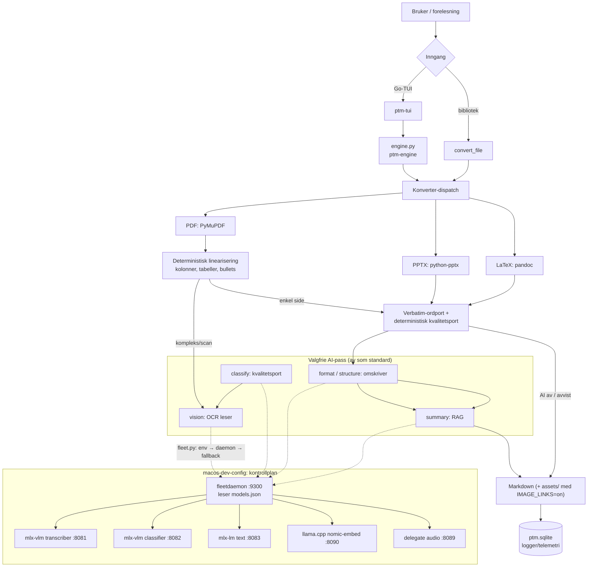

# PresentationToMarkdown — kort presentasjon

## Slide 1 — Prosjektet

- Konverterer **PowerPoint (.pptx)**, **PDF (.pdf)** og **LaTeX-prosjekter** til Markdown
- Bygget for å føre forelesningsslides inn i en Obsidian-vault
- Ett Markdown-dokument per kilde; bildelenker er av som standard (ADR-0047) — AI-beskrivelser av bilder beholdes, `assets/`-uttrekk er opt-in (`IMAGE_LINKS=on` / TUI-innstilling)
- Bevarer **fet/kursiv**, tabeller og lister; per-slide/per-side-overskrifter
- PPTX-notater som sitat; PDF renderer per-side PNG i minnet (lenke kun med `IMAGE_LINKS=on`)
- Grensesnitt: den native Go-TUI-en (`ptm-tui`) med den lokale motoren (`ptm-engine`) og et gjenbrukbart `converter`-bibliotek (ingen UI-avhengigheter); de øvrige grensesnittene er fjernet (ADR-0051)

## Slide 2 — Deterministisk

- Konverteringen er **deterministisk og krever ingen AI**; alle AI-pass er av som standard
- Kun modellteksten er modell-output — geometri, kolonnedeteksjon, ruting og kvalitetsporter er deterministiske heuristikker (ADR-0018/0019/0020)
- **Verbatim-ordport**: AI får ikke endre/utelate ord; avviste sider beholder deterministisk Markdown + `[WARN]`
- Deterministisk kvalitetsport forkaster repetisjonsløkker, placeholder-ekko og løpsk output
- Preflight-gaten (ADR-0039) kan bare gjøre *mindre* arbeid, aldri endre deterministisk output; `off` = byte-identisk baseline
- Konvertering feiler aldri pga. AI — den faller alltid tilbake til deterministisk form

## Slide 3 — Slik serveres AI (lokalt)

- Alt kjører **lokalt på Mac-en (M4, 32 GB)** — ingen sky
- `macos-dev-config` er maskinens LLM-kontrollplan: manifestet `models.json` (daemons + models) leses **kun** av control-daemonen `fleetdaemon` (Go), på `127.0.0.1:9300` (`list/start/stop/status/provision`)
- PtM snakker med modellene via daemonen (`converter/fleet.py`): env-override → daemon → statisk fallback
- Runners: **mlx-lm** (tekst), **mlx-vlm** (visjon), **llama.cpp** (GGUF) — kun Apple Metal
- Modeller: transcriber (Qwen2.5-VL-7B :8081), classifier (:8082), text (Llama-3.2-3B :8083), embeddings (:8090), audio (:8089)
- **On-demand** start (wake-on-demand); modeller lastes av mellom pass (`lifecycle.py`) fordi M4-en mangler OOM-killer
- Modellvekter på ekstern SSD (`HF_HOME`); eksponeres kun lokalt/LAN via Tailscale-ACL

## Slide 4 — Utviklingsmetode: ADR-er

- Alle arkitekturbeslutninger dokumenteres som **ADR-er** i `docs/adr/` (46 stk, MADR-form)
- Fast mal: **Kontekst / Beslutning / Konsekvenser / Alternativer** — beslutningstreet er synlig
- **Uforanderlig når godkjent**: supersede, aldri rediger
- Én beslutning per ADR; egen serie per repo, kryssreferert til delte kontrakter
- Eksempler: 0002 determinisme, 0016 leser/skriver-roller, 0017 modell-residency, 0029 daemon-serving, 0039 preflight-gate
- Testet med `pytest` og syntetiske fixtures

## Prosa (alternativ visning)

### Slide 1 — Prosjektet

PresentationToMarkdown konverterer PowerPoint, PDF og LaTeX til Markdown for å føre forelesningsslides inn i en Obsidian-vault. Ett dokument per kilde; ingen bildelenker som standard — AI-beskrivelser beholdes og `assets/`-uttrekk er opt-in med `IMAGE_LINKS=on`; fet/kursiv, tabeller, lister og per-slide-overskrifter bevares. Grensesnittet er den native Go-TUI-en (`ptm-tui`) med den lokale motoren (`ptm-engine`), i tillegg til et gjenbrukbart `converter`-bibliotek uten UI-avhengigheter (ADR-0051).

### Slide 2 — Deterministisk

Konverteringen er deterministisk og krever ingen AI — alle AI-pass er av som standard. Bare modellteksten er modell-output; geometri, ruting og kvalitetsporter er deterministiske, og en verbatim-ordport hindrer AI-en i å endre eller utelate ord. Preflight-gaten kan bare gjøre mindre arbeid, aldri endre deterministisk output, så konvertering feiler aldri på grunn av AI.

### Slide 3 — Slik serveres AI (lokalt)

All AI kjører lokalt på Mac-en (M4, 32 GB), uten sky. `macos-dev-config` er maskinens LLM-kontrollplan, der `fleetdaemon` (Go) alene leser manifestet `models.json` og eksponerer `list`/`start`/`stop`/`status` på port 9300. PtM snakker med modellene gjennom daemonen via `converter/fleet.py`, med runnerne mlx-lm, mlx-vlm og llama.cpp på Apple Metal; modellene startes on-demand, lastes av mellom pass, og vektene ligger på ekstern SSD.

### Slide 4 — Utviklingsmetode: ADR-er

Alle arkitekturbeslutninger dokumenteres som ADR-er i `docs/adr/` (46 stk) i MADR-form: Kontekst, Beslutning, Konsekvenser og Alternativer, med én beslutning per ADR. En godkjent ADR er uforanderlig og supersedes heller enn å redigeres, og hvert repo har sin egen serie kryssreferert til delte kontrakter. Koden testes med `pytest` og syntetiske fixtures.

## Runtime — prosessdiagram



## Runtime — sekvensdiagram

```mermaid
sequenceDiagram
    autonumber
    actor U as Bruker
    participant IN as Inngang (TUI / bibliotek)
    participant CO as Converter<br/>(convert_file)
    participant FL as fleet.py
    participant FD as fleetdaemon :9300
    participant MS as Modellserver<br/>(mlx-vlm / mlx-lm / llama.cpp)
    participant LG as ptm.sqlite<br/>(logstore)

    U->>IN: velger fil(er) + AI-innstillinger
    IN->>CO: convert_file(paths, output)
    CO->>CO: dispatch (PPTX / PDF / LaTeX)

    alt AI-pass aktivert
        CO->>FL: base_url(modell)
        FL->>FD: GET /list
        FD-->>FL: manifest-projeksjon (host / port / runner)
        FL-->>CO: base_url (env → daemon → fallback)

        CO->>FD: GET /status/<navn>
        alt server nede
            FD->>MS: POST /start/<navn>
            MS-->>FD: klar
        end

        CO->>MS: POST /v1/chat/completions (OCR / omskriv)
        MS-->>CO: generert tekst
        CO->>CO: verbatim-ordport + kvalitetsport
        CO->>FL: release_model(runner)
        FL->>MS: POST /unload (eller keep_alive=0)
    else AI av (deterministisk)
        CO->>CO: ren deterministisk Markdown
    end

    CO->>LG: logg (vision_events / run_config)
    CO-->>IN: ConvertResult (Markdown; assets/ kun med IMAGE_LINKS=on)
    IN-->>U: [OK] / [ERR] / [WARN]
```
